# BG Tutor User Guide

BG Tutor is a local backgammon workbench. You can play against an engine, import and analyze matches, search your library for positions, and turn your own mistakes into practice material. Everything runs on your own computer. Your matches, notes and learning progress stay in your local database.

This guide walks through every workspace in the header and each of its tabs. Each chapter starts with what a newcomer needs and ends with details for stronger players. Exact rules, limits and edge cases are in the [reference](../reference/); a *Details* link at the end of a section leads to the matching part.

| Level | You are … | Start with |
| --- | --- | --- |
| **Novice** | learning the rules and basic strategy, or new to engine analysis | [Playing](#2-playing), the [Coach and Tutor modes](#play-modes), and the [glossary](#13-glossary) |
| **Advanced** | playing tournaments or online and want to find your recurring errors | [Analysis](#3-analysis), [My recurring mistakes](#my-recurring-mistakes), and [flashcards](#flashcards--anki) |
| **Professional** | preparing seriously, comparing engines, or managing a large library | [Compare moves](#compare-moves), [Displayed analysis](#displayed-analysis-and-new-calculations), [All analyzed decisions](#all-analyzed-decisions), [Engine duels](#engine-duels) |

Tips for a particular level are marked with these labels:

> **Novice:** basic tips for getting started.
>
> **Advanced:** working more efficiently and drawing better conclusions.
>
> **Pro:** precise details about sources, depth and units.

## Contents

1. [Finding your way around](#1-finding-your-way-around)
2. [Playing](#2-playing)
3. [Analysis](#3-analysis)
4. [Study](#4-study)
5. [Positions](#5-positions)
6. [Match database](#6-match-database)
7. [Player database](#7-player-database)
8. [Extras](#8-extras)
9. [Profiles and Settings](#9-profiles-and-settings)
10. [Learning paths by level](#10-learning-paths-by-level)
11. [Keyboard reference](#11-keyboard-reference)
12. [Troubleshooting](#12-troubleshooting)
13. [Glossary](#13-glossary)

---

## 1. Finding your way around

Open BG Tutor in your browser at <http://127.0.0.1:8787>. The header is the same in every workspace.

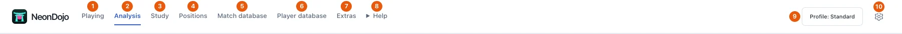

| # | Header item | What you do there |
| --- | --- | --- |
| 1 | **Playing** | Play a match or money session against GNUbg or Open Sage, with optional feedback. |
| 2 | **Analysis** | Review a match move by move, compare candidate moves, and study cube decisions and statistics. BG Tutor opens here. |
| 3 | **Study** | Review flashcards, read learning reports, and practice your recurring mistakes. |
| 4 | **Positions** | Browse saved positions and search every analyzed decision of a player. |
| 5 | **Match database** | Import matches, organize them into databases, search, filter, export, and start bulk analyses. |
| 6 | **Player database** | Look up players, their aliases, PR and match history. |
| 7 | **Extras** | Run engine benchmarks and engine duels, back up the database, and check versions. |
| 8 | **Profile** | Switch configuration profiles and see whether the current settings differ from the saved profile. |
| 9 | **Settings** (gear) | Set the language, appearance, engines, error thresholds, playing defaults and board artwork. |

Each workspace contains further tabs, as the map below shows.

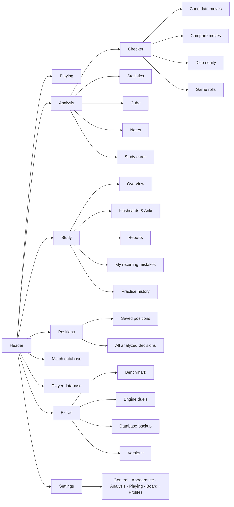

**Keyboard:** Focus a header tab and use **Left**/**Right** to move between workspaces. **Home** selects Playing and **End** selects Extras. The same keys work in the tab rows inside each workspace.

**Navigation style:** The current tab is shown with the accent color and an underline. Buttons with an icon show a tooltip when you hover over them or focus them with **Tab**. If a button has a keyboard shortcut, the tooltip names it.

**What BG Tutor remembers:** Each browser tab keeps its own database selection, search filters, sort order, study deck and analysis filters. Column choices, column widths and board sizes are stored in the browser. The selected match, game and move are restored after a reload. Details: [Configuration profiles](../reference/settings.md#configuration-profiles)

### The typical workflow

Most users follow the same loop. You can enter it at any point.

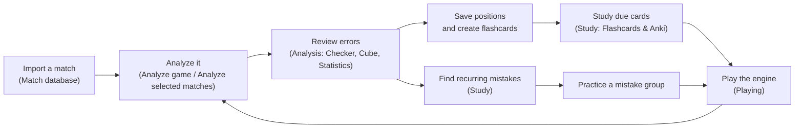

---

## 2. Playing

**Playing** pits you against GNU Backgammon (GNUbg) or Open Sage. Depending on the play mode, BG Tutor stays silent, explains your errors afterwards, or stops you before you play a mistake.

### Starting a match

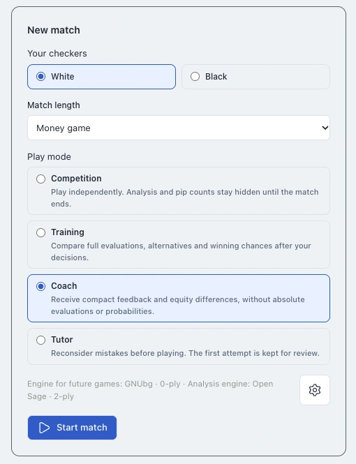

1. Choose **Your checkers**: **White** or **Black**. Your checkers are always shown at the bottom of the board.
2. Choose the **Match length**. You can play a **Money game** or a match of 1 to 25 points.
3. Choose a **Play mode**. The modes are described in the next section.
4. Select **Start match**.

The line above the button shows which engine and strength the bot uses and which engine analyzes your decisions. Select the gear button beside it to change them in **Settings → Playing**. A match keeps the engine settings it was started with. Later changes apply only to new matches.

**Paused Matches** at the top of the page opens the paused sessions in the Match database. From there you can resume one.

### Play modes

| Mode | During the game | Best for |
| --- | --- | --- |
| **Competition** | No analysis, pip counts, error marks or PR until the match ends. | Testing yourself under realistic conditions. |
| **Training** | Full equities and win, gammon and backgammon chances after your decisions. | Learning why one play is better than another. |
| **Coach** *(default)* | Compact feedback with equity differences and the history's severity colors. | Everyday practice. |
| **Tutor** | Warns you **before** you play a checker or cube decision that reaches the error threshold. | Novices, and anyone drilling a weakness. |

Coach and Tutor pause at the **Error** threshold from **Settings → Analysis**, 0.020 by default. You can switch the mode during a match with the **Play mode** menu in the match bar. The current position and any checkers you have already moved stay as they are.

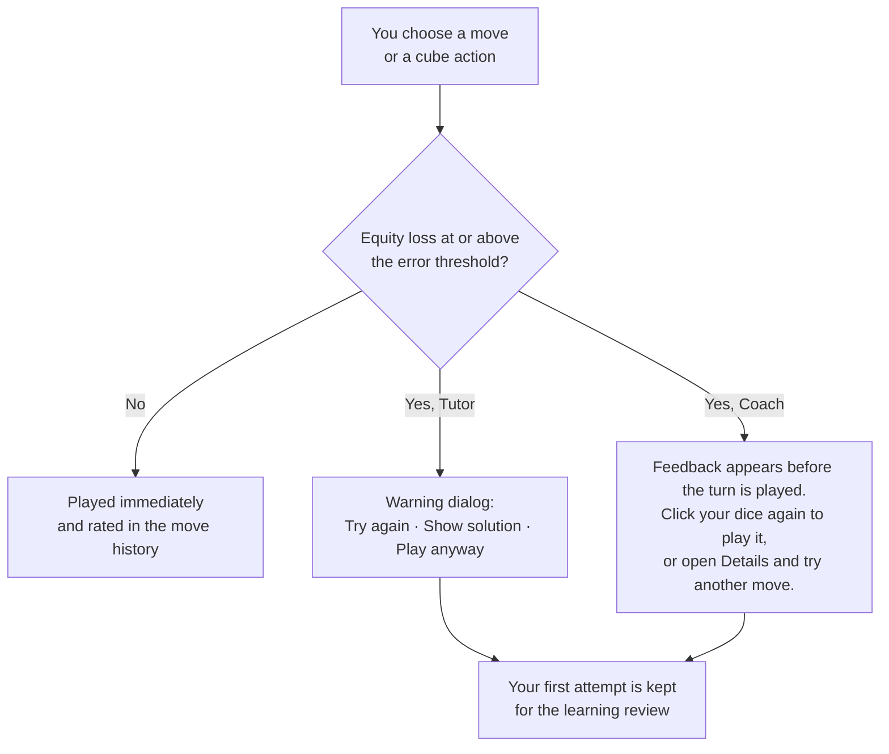

> **Novice:** Start with **Tutor** in short matches of 3 or 5 points. Every warning is a free lesson, and the learning review shows your first attempt next to the better play.
>
> **Advanced:** Use **Coach** for normal practice and play a **Competition** match from time to time. Only matches played without learning aids count when you tick **Only matches played without learning aids** in Study.

Details: [Playing feedback modes](../reference/playing.md#playing-feedback-modes)

### The match screen

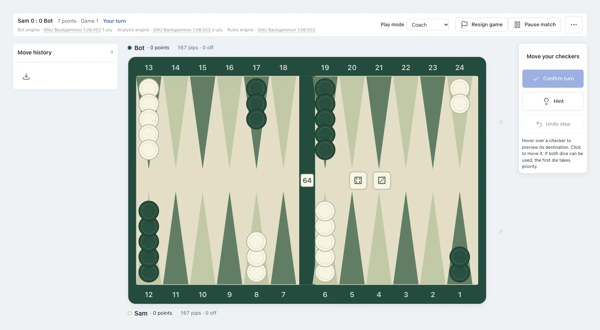

- **Match bar** (top): score, match format, game number, engine and whose turn it is. Hover over the engine name to see its version, the playing and analysis depth and the bear-off direction. On the right are **Play mode**, **Resign game**, **Pause match** and the **⋯** menu with **Forfeit match**, **New match** and **Paused Matches**.
- **Move history** (left): every move with notation, dice and severity colors. Select a past move to review it. An accent frame around the board and the **Return to game** button show that the board is not showing the live position. **Download SGF** exports the match at any time.
- **Board** (center): your checkers are at the bottom. Player rows show names, points and pip counts. Pip counts are hidden in Competition mode.
- **Action panel** (right): names the current step and shows its main button, which is **Roll dice**, **Confirm turn** or **Pass**, together with **Double**, **Hint** and **Undo step** where they apply. A disabled button explains why it is unavailable.

**Moving checkers**

1. Click the dice, or the gap between them, to roll. You can also press **Enter**.
2. Hover over a checker to see where it would go. Click it to move it. If both dice could be used, the first die takes priority. Click the dice before you move to swap their order.
3. **Undo step** (**Z**) takes back one unconfirmed step at a time.
4. **Confirm turn** (**Enter**) completes the move.

**The doubling cube**

- Click the cube, or select **Double** (**D**), to offer a double before you roll. When the cube lifts as you hover over it, you are allowed to double.
- When the bot doubles, a dialog asks you to **Take** or **Pass**.

**Hints:** **Hint** (**H**) opens a movable dialog with the engine's suggestions. Use **Up**/**Down** to step through them, and **Initial**, **Arrows** and **Final** to preview each one on a separate board. Using a hint is recorded as a learning aid.

**Resigning, pausing and forfeiting**

- **Resign game** lets you offer a single, gammon or backgammon resignation. The dialog shows the points at stake and the resulting score. GNUbg decides whether to accept.
- **Pause match** saves the last confirmed position, including the score, dice and any pending decision. Resume it later from the paused board or from **Match database → Paused Matches**.
- **Forfeit match** in the **⋯** menu concedes a point match after confirmation.

**After a game:** A dialog shows the winner, the points won and how they were calculated, for example *Gammon (2) × Cube 2 = 4 points*. After a money game it offers **Next game**, **Pause match** and **End session**. A learning review of each completed money game is saved automatically. You can find it under [Study → Reports](#reports).

**Where played matches go:** Every bot match is archived in **Match database → Bot Matches**, where you can analyze, tag, export or copy it like an imported match.

> **Pro:** The bot's strength in **Settings → Playing** is independent of the analysis depth used for feedback. Learning reviews report a *first-attempt PR*, computed from your original choices at the positions you actually reached. This PR is separate from GNUbg's rating of the moves you finally played.

Details: [Playing against GNUbg](../reference/playing.md#playing-against-gnubg)

---

## 3. Analysis

**Analysis** is the main review screen for a match. It opens with a welcome panel until you open a match.

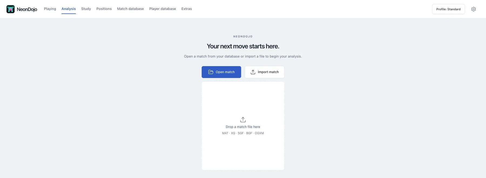

Select **Open match** to go to the Match database, select **Import match**, or drop a file on the panel. See [Importing](#importing) for the supported formats.

### Screen layout

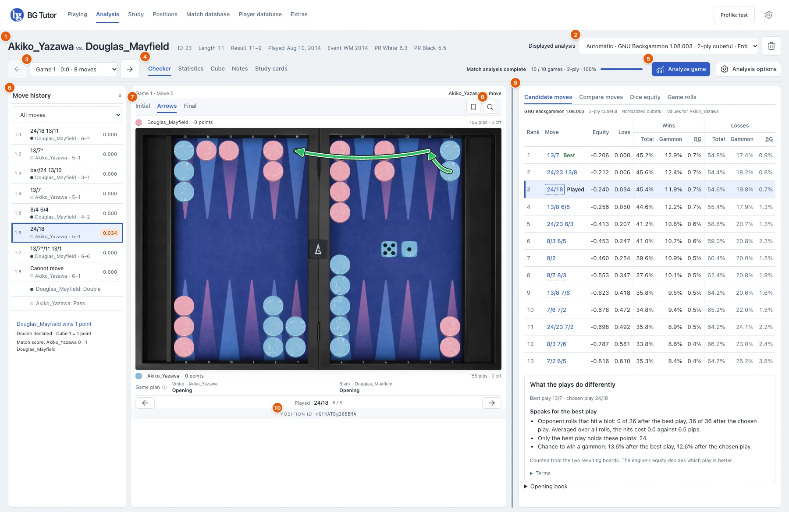

| # | Area | Purpose |
| --- | --- | --- |
| 1 | **Match header** | Players, match ID, length, result, date, event and PR per player, if a complete analysis exists. |
| 2 | **Displayed analysis** | Chooses which saved analysis is shown everywhere in this match. The trash button deletes the selected analysis after confirmation. |
| 3 | **Game selector** | Choose a game, or use the arrows for the previous and next game. Each entry shows the starting score, the number of moves and the Crawford status. |
| 4 | **Analysis tabs** | **Checker**, **Statistics**, **Cube**, **Notes** and **Study cards**. |
| 5 | **Analyze game / Analysis options** | Start an analysis of the selected game, or choose the engine and depth and recalculate a single position or its dice equity. The progress bar shows running jobs. |
| 6 | **Move history** | Every move of the game with notation, player, dice and equity loss. Doubles, takes and passes appear between the checker moves. |
| 7 | **Board views** | **Initial**, **Arrows** and **Final** show the position before, during and after the selected move. |
| 8 | **Save position / Search this position** | Bookmark the decision into [Positions](#5-positions), or search the library for the same board. |
| 9 | **Evaluation pane** | **Candidate moves**, **Compare moves**, **Dice equity** and **Game rolls**. |
| 10 | **Position ID** | GNUbg's 14-character identifier of the board. Use it to search for the exact position. |

**Move history colors:** Each row shows the equity loss of the move. `0.000` means the best move was played and a dash means the move has not been evaluated. Colored badges mark the grades from *Questionable* to *Large Blunder*, as defined in the [error grades](#error-grades) table. Hover over a value to see its grade, source and depth. Use the menu at the top of the list to show **All moves**, **All errors** or a single grade. The filter does not change the board selection.

**Resizing the board:** Drag the divider beside the board, or focus it and use **Left**/**Right**. Hold **Shift** for larger steps. Double-click the divider to make the board as large as the window allows, and press **Enter** to restore the default size. Each tab remembers its own board width.

Details: [Analysis workspace](../reference/analysis.md#analysis-workspace)

### Checker

The Checker tab shows the move history, the board and the evaluation of the selected move side by side.

#### Candidate moves

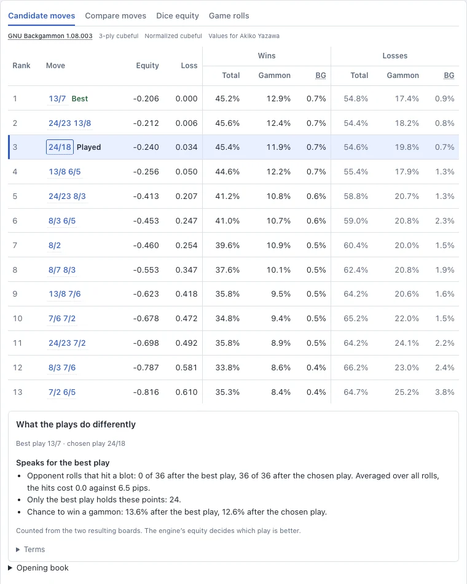

- The header line names the **engine**, the **depth** (for example *2-ply cubeful*), the **unit** and **whose perspective** the values are shown from.
- **Best** marks the engine's choice and **Played** marks the recorded move.
- **Equity** is the expected result of each move. **Loss** is the difference to the best move.
- **Wins** and **Losses** show total, gammon and backgammon chances. Total includes gammons and backgammons, and gammon includes backgammons.
- Select a move, or press **Enter** on it, to preview it on the board. **Up**/**Down** move to the next or previous candidate. **Left** shows *Initial* and **Right** shows *Final*.
- **What the plays do differently** compares the best play with the chosen play on the board. It counts facts such as hits, the opponent's shots and their pip cost, points held, the longest row of adjacent points, checkers out of play or stacked, blots, and gammon chances. The counts describe the plays; the engine's equity decides which one is better. **Terms** explains equity, equity loss, PR and ply.
- **Opening book** expands a reference from BackgammonDB or the XG Opening Book, if one is configured.

> **Novice:** You don't need to read every column. Compare the **Loss** of your move with the grade colors. Then switch to **Arrows** and look at what the best move does differently on the board.

Details: [Candidate comparison and decision review](../reference/analysis.md#candidate-comparison-and-decision-review)

#### Compare moves

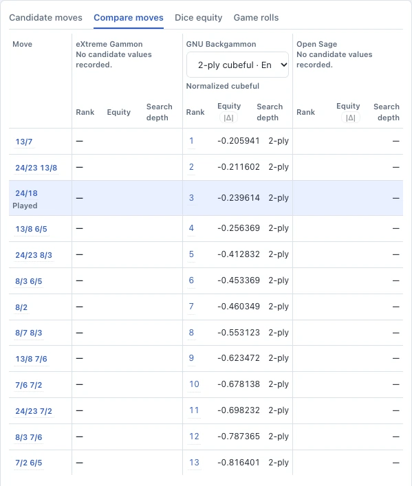

**Compare moves** lines up saved eXtreme Gammon, GNU Backgammon and Open Sage analyses of the same position. Moves that reach the same board share a row. Each engine column shows the rank, equity and actual search depth. A dash means that engine has no value for that move.

- Use the menu in a column header to choose another saved analysis of that engine.
- Select **|Δ|** in a local engine's equity column to sort by the largest difference from XG. Arrows show whether the local rank is higher or lower than XG's rank.
- Select a cell to preview that engine's version of the move on the board.

> **Pro:** Compare moves starts with the deepest loaded result for each engine. The local columns show their equity minus XG's equity only where the values are comparable. Equities are never compared across different units.

#### Dice equity

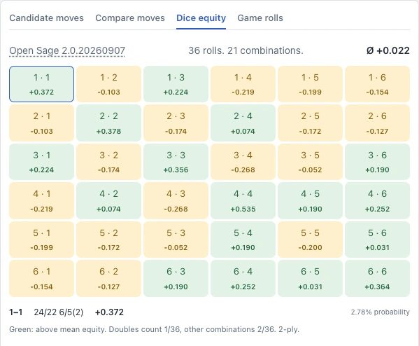

**Dice equity** shows how good each roll would be in the current position. The 6 × 6 grid covers all 36 ordered rolls. They come from 21 distinct pairs: each double counts once (1/36) and each other pair counts twice (2/36). **Ø** is the weighted average over all rolls. Green cells are above the average and yellow cells are below it. Select a cell to see the best play for that roll and its probability. When a roll has no legal move, the forced pass is evaluated.

If no saved result exists, BG Tutor starts the calculation automatically with the engine and depth of your active profile. Use **Analysis options → Recalculate dice equity …** to calculate again at a different depth.

> **Advanced:** Dice equity shows which rolls you are playing for and which rolls hurt you. It helps when you are deciding between a safe play and a bold one.

#### Game rolls

**Game rolls** shows how often each roll came up in the selected game. Use it to check whether a game was decided by the dice.

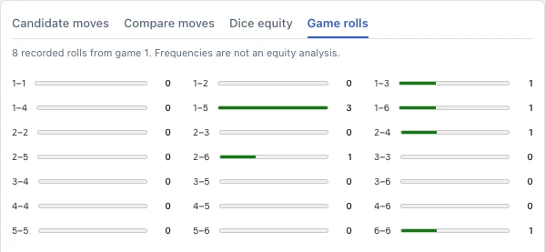

### Analysis options and Analyze game

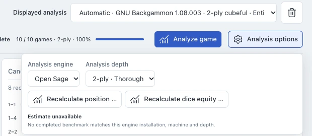

- **Analyze game** analyzes the selected game with the engine and depth shown in **Analysis options**. The time estimate is based on your [benchmarks](#benchmark). To analyze whole matches, use [Analyze selected matches …](#bulk-actions) in the Match database.
- **Recalculate position …** and **Recalculate dice equity …** calculate only the current position at the depth you choose.
- Analyses run as background jobs. They keep running when you switch tabs or close the dialog. Progress and remaining time appear in the header.

| Depth | Speed | Typical use |
| --- | --- | --- |
| 0-ply | instant | quick checks, fast bot play |
| 1-ply | fast | quick reviews |
| **2-ply** *(default)* | moderate | standard match review |
| 3-ply | slow | close decisions |
| 4-ply | very slow | deep study of key positions and full-match analysis on fast machines |

> **Pro:** Every job keeps the engine version, depth and move filter it started with, even if you change Settings while it is running.

Details: [Analysis time estimates](../reference/analysis.md#analysis-time-estimates) · [Analysis jobs](../reference/analysis.md#analysis-jobs) · [Settings and engines](../reference/settings.md#settings-and-engines)

### Displayed analysis and new calculations

A match can have several saved analyses: imported XG, GNUbg or BGBlitz values from the original file, and local GNUbg or Open Sage analyses at different depths. **Displayed analysis** picks **one** of them for the checker and cube review, the move colors, Statistics and new flashcards.

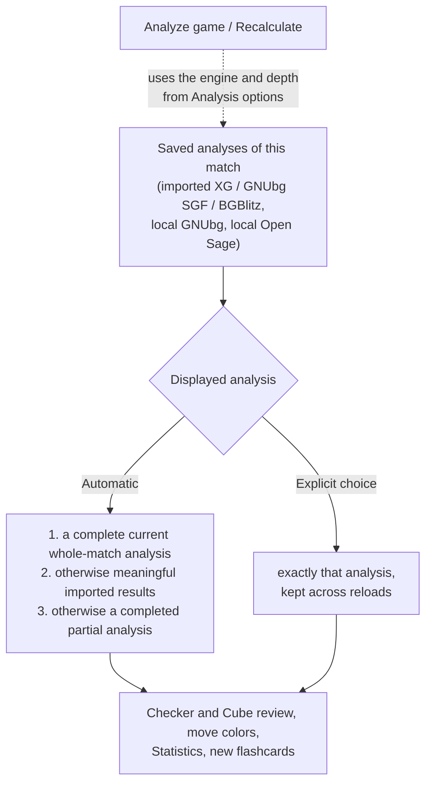

- Positions that the chosen analysis does not cover stay **unavailable**. BG Tutor never fills the gaps with values from another analysis.
- **Load more analyses** shows older results in the same list.
- **Delete analysis** permanently removes the selected result after confirmation. Deleting imported values never changes the original match file.

Details: [Imported analysis and opening books](../reference/analysis.md#imported-analysis-and-opening-books)

### Statistics

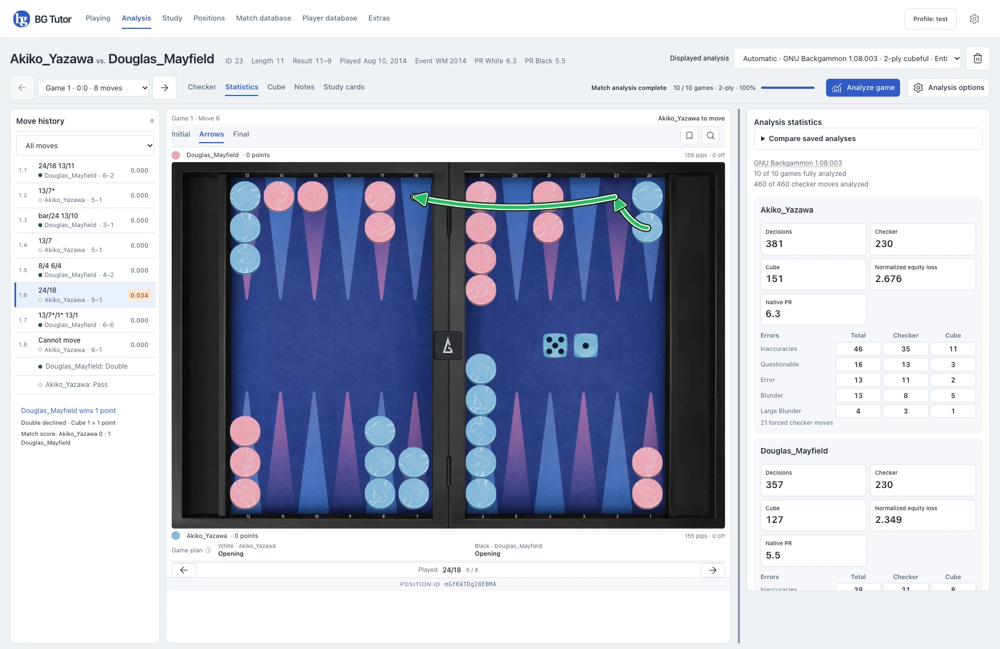

The Statistics tab shows the selected analysis for each player:

- the number of **decisions**, split into checker and cube decisions
- the **normalized equity loss**
- the **native PR** (performance rating)
- an **error breakdown** by grade, as Total, Checker and Cube

Click any count to open the matching decisions in the **Checker** or **Cube** tab. A count in the game overview filters to that game.

**Compare saved analyses** puts any two saved analyses side by side, for example XG and GNUbg 2-ply. The displayed analysis does not change.

> **Pro:** GNUbg counts decisions differently from XG, so PR values from the two programs are not directly comparable. PR requires a complete native analysis. Imported analyses don't supply native PR.

Details: [Checker and cube error statistics](../reference/analysis.md#checker-and-cube-error-statistics) · [How PR is calculated](../reference/library.md#table-and-metadata)

### Cube

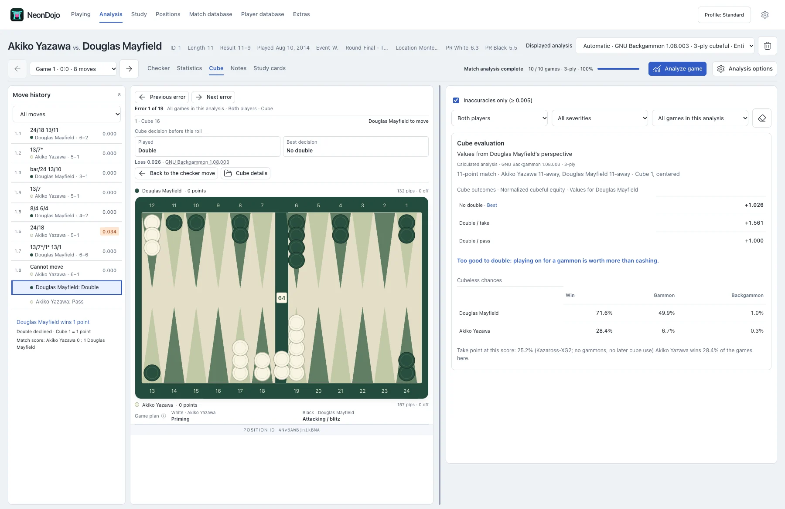

The Cube tab reviews **doubling decisions only**. Use **Previous error** and **Next error** above the board, or press **E** / **Shift+E**, to step through them. Filter by player, severity and game. **Inaccuracies only** hides decisions below the *Questionable* threshold. **Reset filters** (the eraser button) restores the default filters.

For each decision you see:

- the action that was **played** and the **best** action, together with the loss and the analysis source
- the **cube context**, described in words: match length, how many points each player still needs, Crawford status, and the cube value and owner
- the **cube outcomes** *No double*, *Double / take* and *Double / pass*, with their unit and perspective, and a note such as *Too good to double*
- the **take point** for this score, which is 25 % in money play and is derived from the Kazaross-XG2 match equity table in match play
- **Calculate winning chances**, for older analyses that did not save cubeless chances
- **Cube details**, for imported decisions, which opens the original evaluation and notes
- **Back to the checker move**, which returns to the related checker play

> **Advanced:** Compare the game winning chances with the take point. If your chances are well above the take point, it is a take. Gammon chances and later cube use shift the real decision. The engine's equities include both, so check them before you rely on the simple rule.

Details: [Cube context, take point and move explanations](../reference/analysis.md#cube-context-take-point-and-move-explanations)

### Notes

Choose **Match**, **Game** or **Position** and add **tags** and a **comment**. Press **Enter** or **Add tag** after each tag. A note can have up to 30 tags of 64 characters each and a comment of up to 20,000 characters. Select **Save notes** to store them. Unsaved drafts survive switching tabs. If someone else saved a newer version, BG Tutor reports a conflict and keeps your draft.

**Cube and move notes** lists game notes and recorded actions such as doubles, takes, passes and accepted resignations. Each entry shows the board immediately before the action. You can search tags and comments from the [Match database](#search-and-filters) with **Notes**.

Details: [Tags and comments](../reference/analysis.md#tags-and-comments)

### Study cards

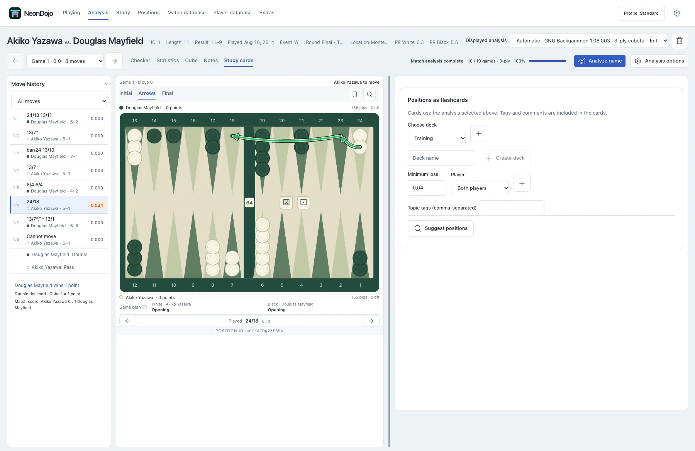

Use this tab to turn analyzed positions into flashcards.

1. **Choose deck**, or create one with **Create deck**.
2. Add the **current position**, or set a **Minimum loss** and a **Player** to import that player's errors from the selected game.
3. **Suggest positions** proposes up to ten decisions from the whole match. Up to three of them come from mistake groups that recur for this player in other matches, and the rest are the largest losses. Choose the cards you want to keep.
4. Optional **Topic tags** help you filter cards later. Use `::` for subtopics, for example `cube::take-point`.

A card is identified by its board, its full match context and its question type. Adding the same decision to another deck reuses the card and its review progress.

Details: [Create and manage decks](../reference/study.md#create-and-manage-decks)

---

## 4. Study

**Study** brings together everything that helps you remember what you learned. It has five tabs.

### Overview

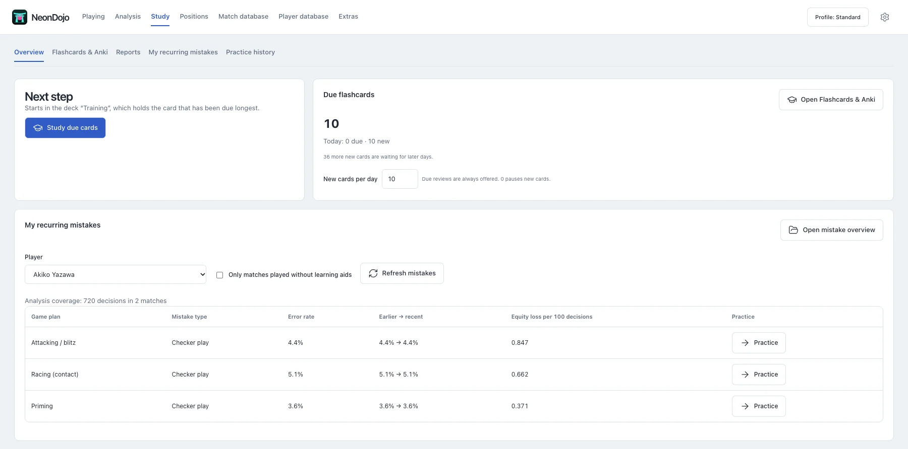

- **Next step** starts the deck that holds the card that has been due longest. If no cards are due, it recommends your costliest mistake group.
- **Due flashcards** shows today's due reviews and new cards. **New cards per day** limits how many cards you see for the first time each day, 10 by default. Set it to 0 to pause new cards. Due reviews are always offered.
- **My recurring mistakes** shows the top mistake groups for a player. **Open mistake overview** opens the full list.

Details: [Study](../reference/study.md#study)

### Flashcards & Anki

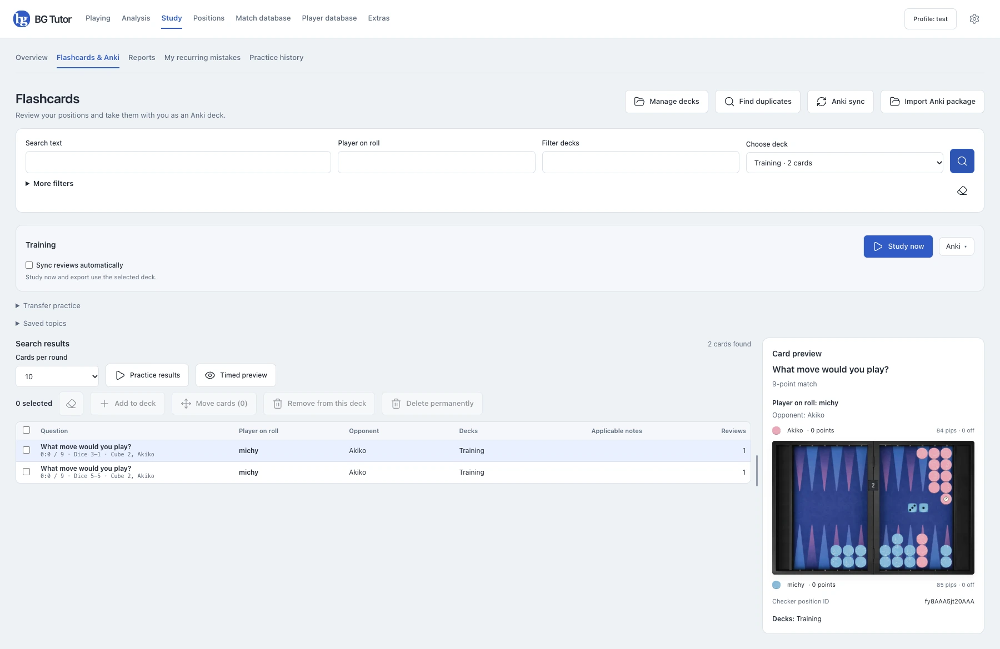

- **Choose deck** selects the deck. **Manage decks** creates, renames and deletes decks.
- Search cards by text, player on roll, deck or **More filters**, which include topic tags, game plan and decision type. The table supports selection and bulk actions: **Add to deck**, **Move cards**, **Remove from this deck** and **Delete permanently**. The last one asks for confirmation.
- **Study now** opens the next due card of the deck.
- **Practice results** starts a shuffled round of 10 or 20 cards from the current filters. These rounds never change your review schedule.
- **Timed preview** shows the filtered cards with separate question and answer times.
- **Transfer practice** checks whether a lesson transfers to new positions. It offers a baseline and a follow-up round of unseen decisions. Repeat the same topic after 7 to 14 days.
- **Saved topics** stores a set of card filters for later.
- **Find duplicates** finds cards that are stored more than once.
- **Anki**: **Download Anki deck** exports an `.apkg` file. **Import Anki package** imports third-party decks. **Send to Anki** and **Sync Anki reviews** exchange cards and reviews with Anki Desktop through AnkiConnect. **Sync reviews automatically** keeps a deck in sync in the background, and **Anki sync** shows the status of each linked deck.

#### Studying a card

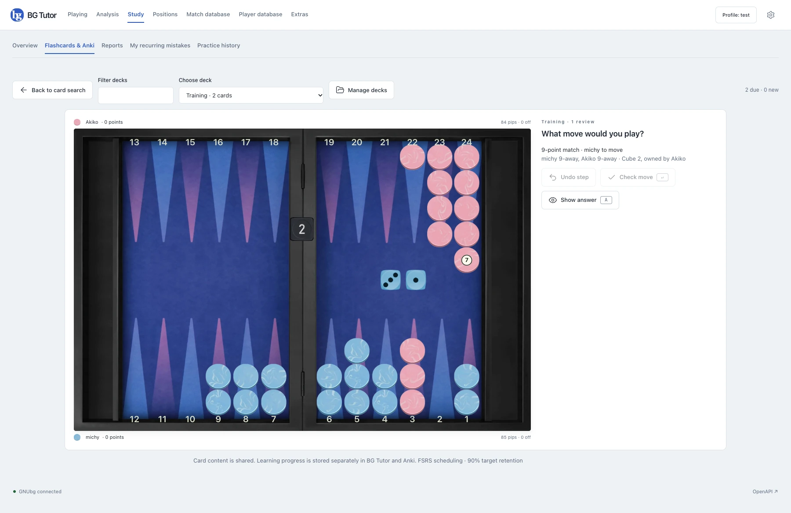

1. Read the context: match length, score, whose turn it is, and the cube value and owner.
2. Answer:
   - **Checker card:** play the whole move on the board. **Undo step** corrects it before you check it.
   - **Cube card:** choose **No double** or **Double** (keys **N**/**D**), or **Take** or **Pass** (keys **T**/**P**).
3. **Check move** (**Enter**) evaluates your answer and shows the best answer and its source. **Show answer** (**A**) reveals the solution without grading, so you can assess yourself.
4. Rate how well you remembered it: **Again**, **Hard**, **Good** or **Easy** (keys **1**–**4**). BG Tutor schedules the next review with the FSRS algorithm at a target retention of 90 %.

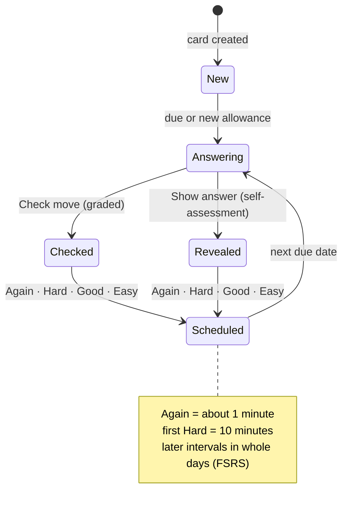

A legal answer that loses less than 0.040 equity counts as **playable**.

> **Novice:** Be honest when you rate a card. *Again* only means you will see the card again soon. It is not a penalty.
>
> **Advanced:** Rate **after** you have read the explanation. The rating is for your memory, while the check grades your play. BG Tutor keeps the two separate.

Details: [Flashcards and Anki](../reference/study.md#flashcards-and-anki)

### Reports

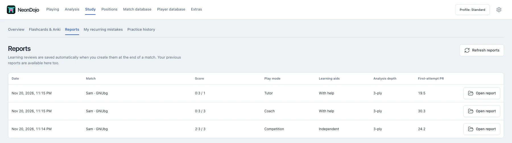

A **learning review** records your decisions in a game or match from Playing. Money games are reviewed automatically after each game. For a point match, create the review with **Learning review** in the move history, or with **Create AI assessment** when the match ends. Reports lists all saved reviews grouped by money session or match. Each entry shows the date, score, play mode, whether learning aids were used, the analysis depth and the first-attempt PR. Select **Open report** to see it.

- **Decisions and attempts** lists your first attempts, retries and corrections. Select a decision to see the original position and the engine's recommendation, with **Initial**, **Arrows** and **Final** views.
- **AI assessment** (optional, point matches only) writes a summary covering ten topics, up to three key decisions and practice tasks. It is created only when you start it. An OpenAI API key must be configured on the backend. Personal names, notes and raw SGF are left out of the request.

Use **Left**/**Right** to switch between the report tabs and **Escape** to return to the archive.

Details: [Reports](../reference/study.md#reports) · [AI assessment](../reference/study.md#ai-assessment)

### My recurring mistakes

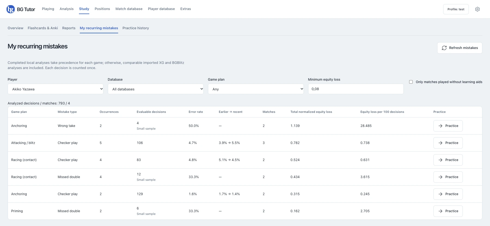

Choose a **Player**, and optionally a **Database**, a **Game plan** and a **Minimum equity loss** (0.08 by default). BG Tutor groups the player's errors by **game plan** and **mistake type**.

| Column | Meaning |
| --- | --- |
| Game plan | The structure of the position: *Opening*, *Pure race*, *Racing (contact)*, *Attacking / blitz*, *Priming* or *Anchoring*. |
| Mistake type | *Checker play*, *Missed double*, *Premature double*, *Wrong take*, *Wrong pass*, or unclassified cube errors. |
| Evaluable decisions / Error rate | How often the situation came up, and how often it went wrong. Small samples are labeled. |
| Earlier → recent | Error rate in the older half of the player's matches compared with the newer half. |
| Equity loss per 100 decisions | The cost of the mistake group, a good guide for what to practice first. |

**Practice** opens a round of saved examples from this group in shuffled order. Play the checker move, or choose the cube action, and compare your answer with the original decision. Rounds about missed doubles, wrong takes or wrong passes also include correct examples, so the answer cannot be guessed from the topic.

**Only matches played without learning aids** limits the statistics to imported matches and Competition games played without hints.

> **Advanced:** Focus on the groups with the highest *equity loss per 100 decisions* that appear in at least two matches. A rare blunder costs less in the long run than a small error that you repeat in every match.
>
> **Pro:** Each match contributes only the decisions of its **displayed analysis**. Decisions from different analyses are never combined.

Details: [My recurring mistakes](../reference/study.md#my-recurring-mistakes)

### Practice history

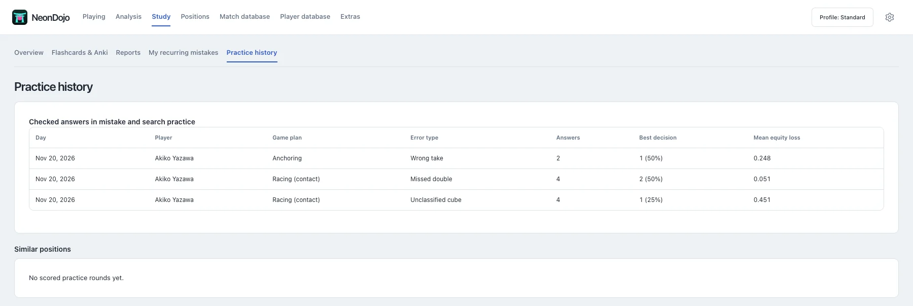

Practice history records every checked answer from mistake practice and search practice: the day, player, game plan, error type, number of answers, how often you found the best decision, and your mean equity loss. Rounds from **Similar positions** practice appear in their own section.

---

## 5. Positions

**Positions** has two views, which you select at the top of the page.

### Saved positions

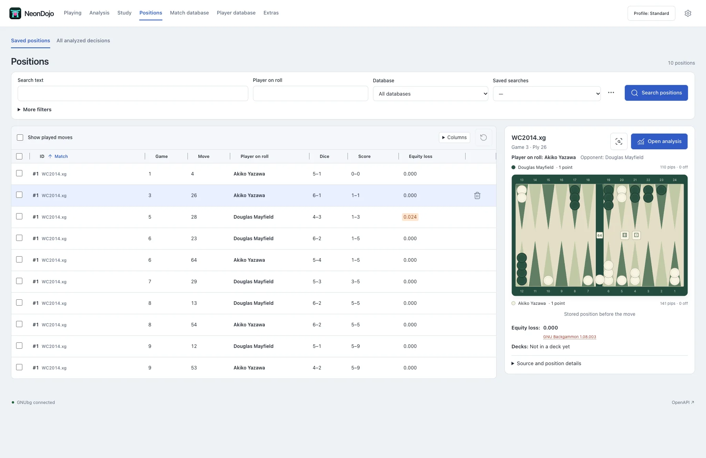

This is your personal collection of decisions. You add positions with **Save position** in Analysis. A saved position keeps its full match context, even if you later delete the original match.

- **Search row:** text, player on roll, database and **Saved searches**. The **⋯** menu next to Saved searches saves, deletes and reloads searches.
- **More filters** are grouped into **Match**, **Position**, **Analysis**, and **Tags and comments**. They include the position ID, roll, score, Crawford, cube, equity loss and more. One die matches either die of the roll, and a pair matches in either order.
- Applied filters appear as chips. Remove a chip to update the results immediately.
- **Show played moves** reveals the recorded decision. It starts switched off, so the answers stay hidden while you study.
- Select a row to see a large preview with the equity loss, decks, tags and notes. **Open analysis**, or **Enter** or a double-click, opens the exact decision in Analysis. The icon beside it finds **similar positions**.
- Select rows with the checkboxes, up to 200, and use **Add to deck** or **Remove from collection**. Removing offers **Undo**.

### All analyzed decisions

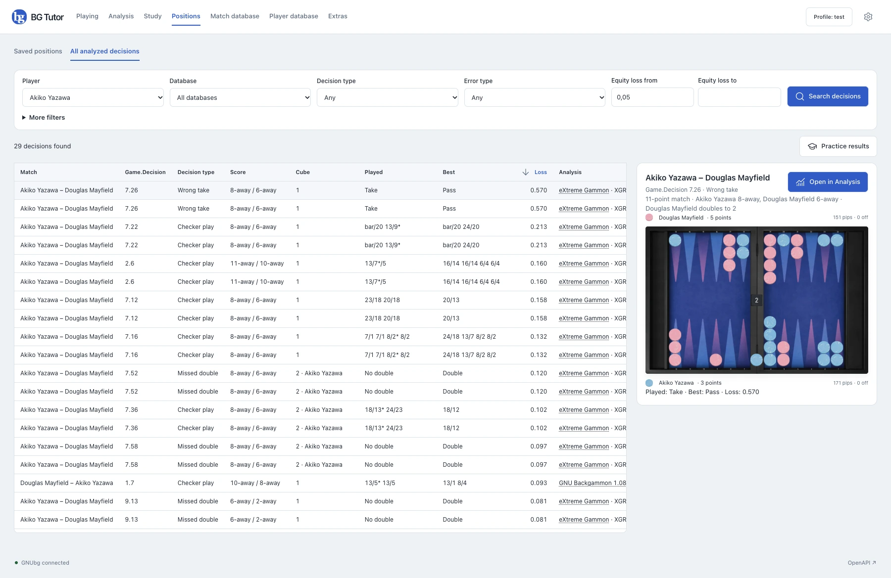

This view searches **every** checker and cube decision of one player in the displayed analyses, whether or not you saved the position.

1. Choose a **Player**. You can also set the database, decision type (checker or cube), error type and an equity-loss range.
2. Select **Search decisions**. The results start with the largest loss. Select the **Loss** heading to reverse the order.
3. Select a row, or move with the arrow keys, to preview the board and its cube context. **Open in Analysis** jumps to the decision.
4. **Practice results** turns up to 20 errors on the current page into a practice round.

> **Pro:** Use **More filters** to narrow the search to a score, for example *2-away / 4-away*, or to a cube value and owner. This lets you build a drill set for a specific match situation, such as double-match-point or post-Crawford positions.

Details: [Saved positions and searches](../reference/library.md#saved-positions-and-searches)

---

## 6. Match database

The Match database stores all your matches in named collections.

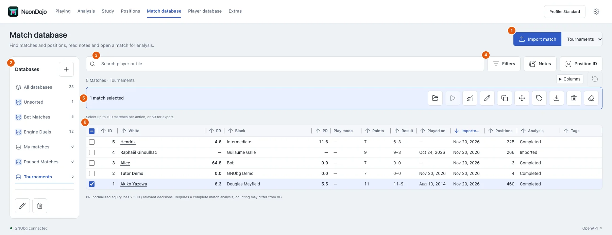

| # | Area | Purpose |
| --- | --- | --- |
| 1 | **Import match** and destination | Import one or more files into the database selected beside the button. |
| 2 | **Databases** | Choose a collection, or **All databases**. Use **+** to create a new one. |
| 3 | **Search** | Find matches by player or file name. |
| 4 | **Filters / Notes / Position ID** | Advanced filters, a search of tags and comments, and an exact board search. |
| 5 | **Actions** | Actions for the selected matches. They become available once you select a match. |
| 6 | **Match table** | Sortable columns with PR, score, dates, event, analysis status and tags. |

### Databases

BG Tutor creates four **system databases** automatically. They cannot be deleted.

| Database | Contents |
| --- | --- |
| **Unsorted** | Imports without a chosen destination |
| **Bot Matches** | Every match you played in **Playing** |
| **Paused Matches** | Paused play sessions, ready to resume |
| **Engine Duels** | Completed matches from [Engine duels](#engine-duels) |

You can create, rename, describe and delete your own databases. **Empty database** is available for *Unsorted*, *Bot Matches* and *Engine Duels*. It requires confirmation, and saved positions, flashcards and their review history are kept.

Details: [Match databases](../reference/library.md#match-databases)

### Importing

Select **Import match**, or drop files on the Analysis welcome panel. Supported formats are **MAT** (Jellyfish/GNUbg), **XG** (eXtreme Gammon), **SGF** (GNUbg), **BGF** (BGBlitz) and **OGXM**. Each file is imported separately, and duplicates and errors are reported per file. Analyses stored in the file are kept as *imported analysis* with their original depth and units.

Unsupported content is rejected, for example XG1 files, edited starting positions, beavers and other variants.

Details: [Import formats](../reference/library.md#import-formats)

### Search and filters

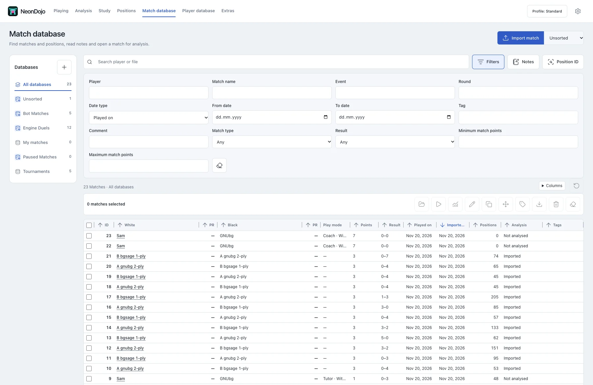

- **Filters** searches by player, match name, event, round, date range, tag, comment, match type, result and match points.
- **Notes** searches tags and comments. Free text must be 3 to 200 characters. You can add an exact tag, a note type and a database.
- **Position ID** finds every occurrence of an exact board in the library. Each occurrence gets its own row with its game and move. Click the move number to open exactly that occurrence.
- Applied filters appear as chips below the search field.

Click a column heading to sort ascending, and click it again to sort descending. **Columns** shows, hides and reorders columns. Drag a header edge to resize a column, and use **Reset column widths** to restore the defaults. Hover over a row to see a summary with PR, analysis profile and excerpts from the notes.

### Bulk actions

| Action | Selection | Notes |
| --- | --- | --- |
| **Open match** | 1 match | Opens it in Analysis. **Enter** or a double-click does the same. |
| **Resume match** | 1 paused or unfinished bot match | Continues it in Playing. |
| **Analyze selected matches …** | 1 or more | Uses one engine and depth for all of them. For a single match the dialog also shows a time estimate. **Bulk analysis** above the list shows the progress. |
| **Edit match details** | 1 match | Display name, played date, event, round, venue and result. |
| **Copy** / **Move** | up to 100 | Copies get new IDs and keep their notes and analyses. Moves keep their IDs. |
| **Tags** | up to 100 | Edit the tags of the selected matches. |
| **Export** | up to 50 | Original file or SGF. Several matches are exported as a ZIP. |
| **Delete** | up to 100 | Requires confirmation and skips matches that are being analyzed. Saved positions and flashcards survive. |

> **Novice:** After importing your first match, select it and choose **Analyze selected matches …** at the default 2-ply. If you keep the dialog open until the analysis finishes, BG Tutor opens **Statistics** for the match. If you close it, the analysis continues in the background.
>
> **Pro:** The **ID** column is a stable match number. It survives renames and moves, and copies receive new numbers. Use **Position ID** together with the **Database**, **Game** and **Move** columns to find out how often, and in which matches, a reference position occurred.

Details: [Filtering and navigating matches](../reference/library.md#filtering-and-navigating-matches) · [Bulk actions and exports](../reference/library.md#bulk-actions-and-exports)

---

## 7. Player database

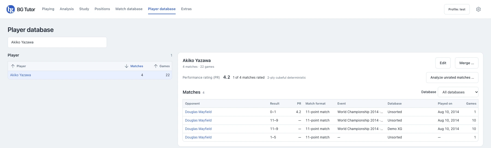

The Player database lists everyone who appears in your matches.

- **Search** by display name or imported alias. Sort by name, matches or games.
- Select a player to see the **profile**: other names (aliases), the **PR** for each analysis profile, and all matches with the opponent, score, PR, format, event, database and date. From two fully analyzed matches on, a chart shows the PR per match with a ten-match average, split into checker and cube play.
- Click a match row to open the match. Click an opponent's name to switch to their profile.
- **Edit** changes the display name or adds an alias for future imports.
- **Merge …** combines two profiles, for example *Akiko_Yazawa* and *Akiko Yazawa*. The matches and aliases of the absorbed profile move to the profile you keep.
- **Analyze unrated matches …** opens the analysis dialog for all of the player's matches that don't have a PR yet.

> **Advanced:** Merge the profiles of your own online usernames first. Then your PR trend, *My recurring mistakes* and *All analyzed decisions* cover all your matches.

Details: [Player database](../reference/library.md#player-database)

---

## 8. Extras

### Benchmark

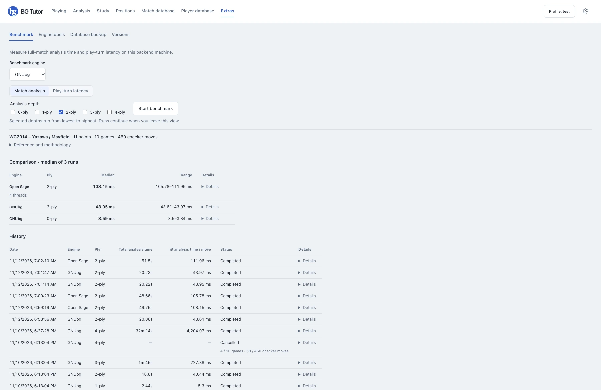

The benchmark measures how fast your computer runs the engines on a fixed reference match: WC2014, Yazawa against Mayfield, with 11 points, 10 games and 460 checker moves.

1. Choose the **Benchmark engine**: GNUbg or Open Sage.
2. Choose **Match analysis** or **Play-turn latency**.
3. Tick one or more depths and select **Start benchmark**. The depths run from lowest to highest in the background. **Cancel run** stops the run.

**Comparison** shows the median and range of the last three runs for each engine and depth. BG Tutor uses these results for the time estimates of analyses. While a benchmark runs, other engine work waits.

Details: [Engine benchmark](../reference/extras.md#engine-benchmark)

### Engine duels

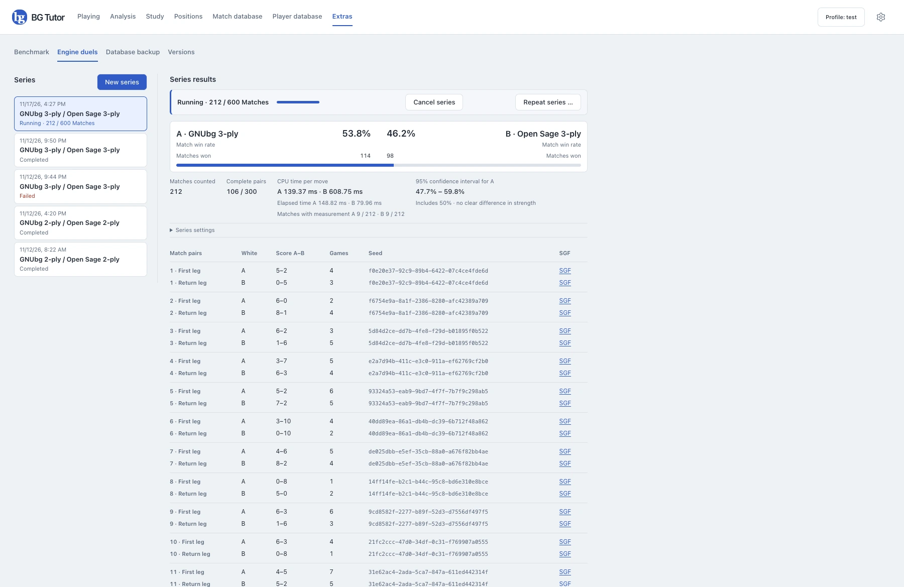

Engine duels let two engines play each other many times so you can compare their strength.

- **New series**: choose the engine and depth for each side, the format, the match length (1 to 25 points) and the number of matches or pairs, up to 1,000. **Money games without cube** plays blocks of cubeless money games instead.
- **Paired with sides swapped** (default) plays every set of dice twice, with the engines on opposite sides. This reduces the luck factor considerably.
- Results show each side's **match win rate**, the matches won, the **CPU time per move**, and a **95 % confidence interval** once the sample is large enough. The interval tells you whether the result could still be 50 %.
- Each completed match is saved in **Match database → Engine Duels** and can be downloaded as SGF. **Repeat series …** runs the same settings and seed again.

Details: [Engine duels](../reference/extras.md#engine-duels)

### Database backup

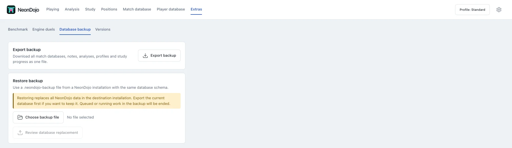

- **Export backup** downloads a single `.bgtutor-backup` file. It contains all match databases, original files, notes, analyses, saved positions, player profiles, settings and learning history.
- **Restore backup** **replaces all data** of the installation with the backup.

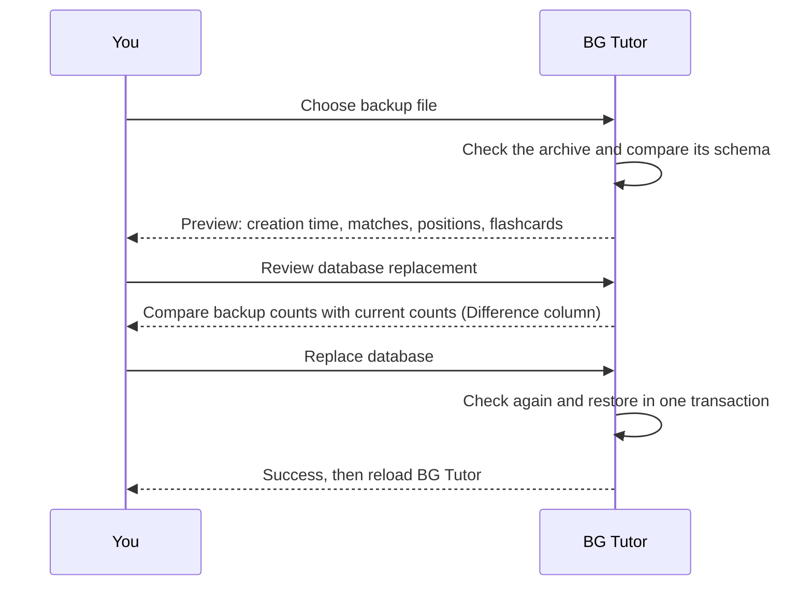

> **Novice:** Export a backup regularly, and always before you restore another backup or move to a new computer.

Details: [Database backup](../reference/extras.md#database-backup)

### Versions

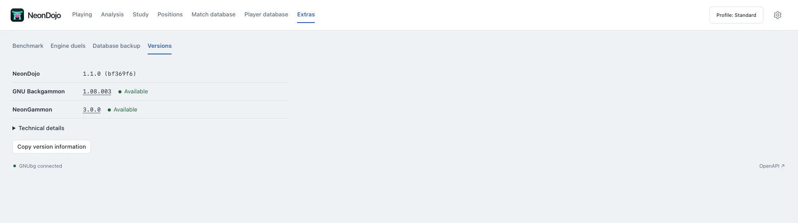

**Versions** shows the BG Tutor build and the versions of GNU Backgammon and Open Sage, and whether they are available. **Technical details** shows the full commit and the engine version output. **Copy version information** copies a report you can attach to a bug report.

Details: [Version information](../reference/extras.md#version-information)

---

## 9. Profiles and Settings

### Profiles

The **Profile** button in the header shows the active configuration profile. It is marked *modified* when your current settings differ from the saved profile. Open it to:

- switch to another profile,
- choose **Show changes** to list each changed setting with its saved and current value, and restore single values with the arrow,
- choose **Manage profiles** to open **Settings → Profiles**.

A profile stores engines, default depths, error thresholds, playing defaults, language, sound, appearance, board artwork and opening-book references. Engine paths belong to each computer and are not part of a profile.

Details: [Configuration profiles](../reference/settings.md#configuration-profiles)

### Settings

Select the gear in the header. Choose a category on the left. **Apply** saves your changes and keeps the dialog open. **Close** returns to the workspace. If you have unapplied changes, BG Tutor asks whether to **Apply**, **Discard draft** or **Keep editing**. **Up**/**Down** switch between categories.

<table>
<tr>
<td width="50%">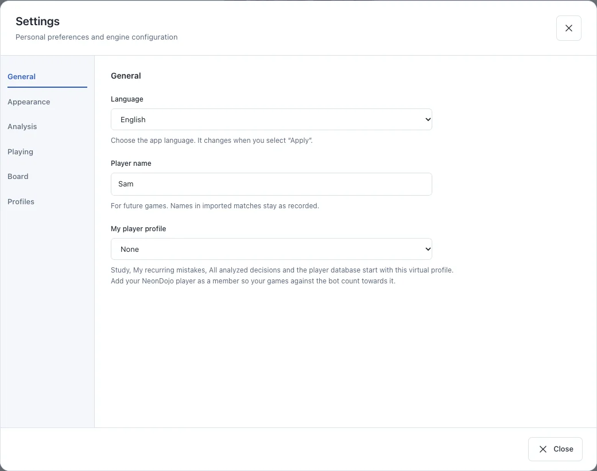 <b>General</b>: the app language (Deutsch, English, Español, Français, Italiano, Polski) and your player name for new games.</td>
<td width="50%">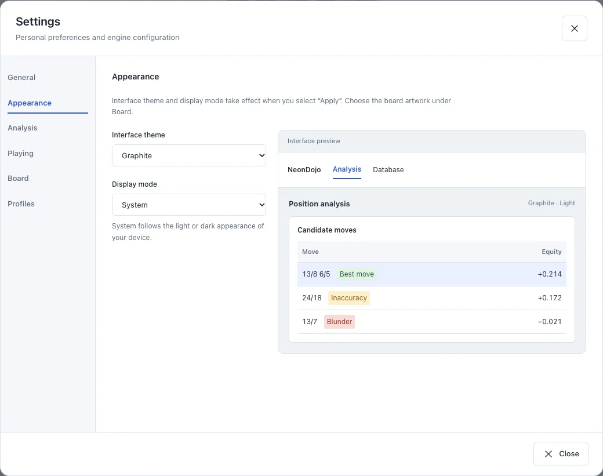 <b>Appearance</b>: the <i>Graphite</i>, <i>Club</i> or <i>Paper</i> theme with <i>Light</i>, <i>Dark</i> or <i>System</i> mode, with a live preview.</td>
</tr>
<tr>
<td>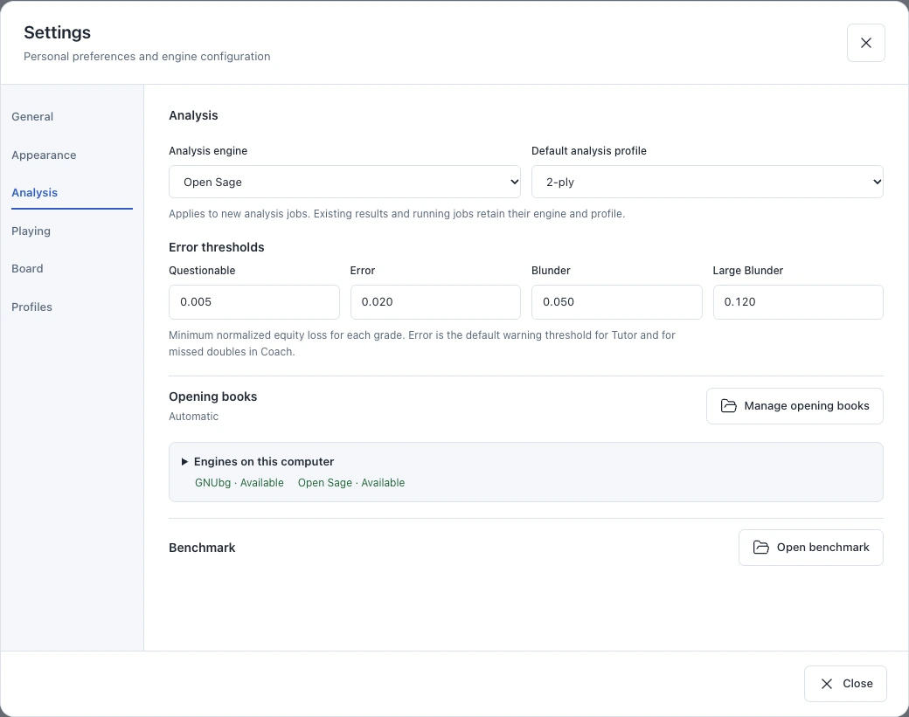 <b>Analysis</b>: analysis engine and default depth, the four error thresholds, opening books, <i>Engines on this computer</i> (paths, installation check, threads) and a link to the benchmark.</td>
<td>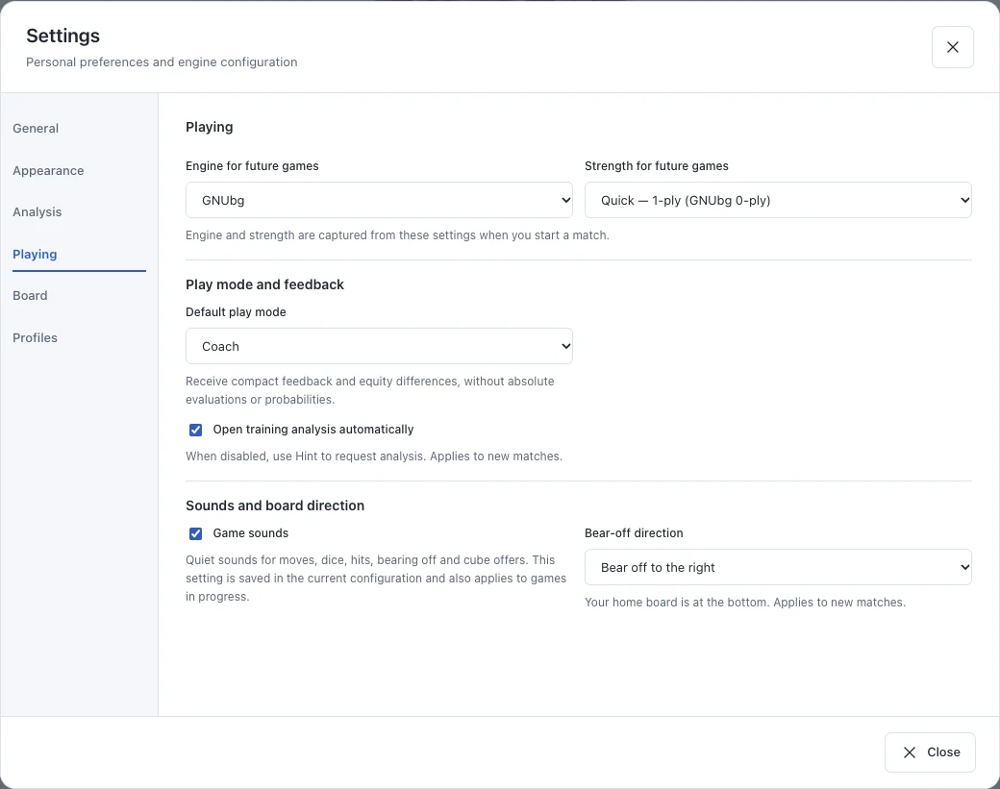 <b>Playing</b>: bot engine and strength, default play mode, <i>Open training analysis automatically</i>, game sounds and bear-off direction.</td>
</tr>
<tr>
<td>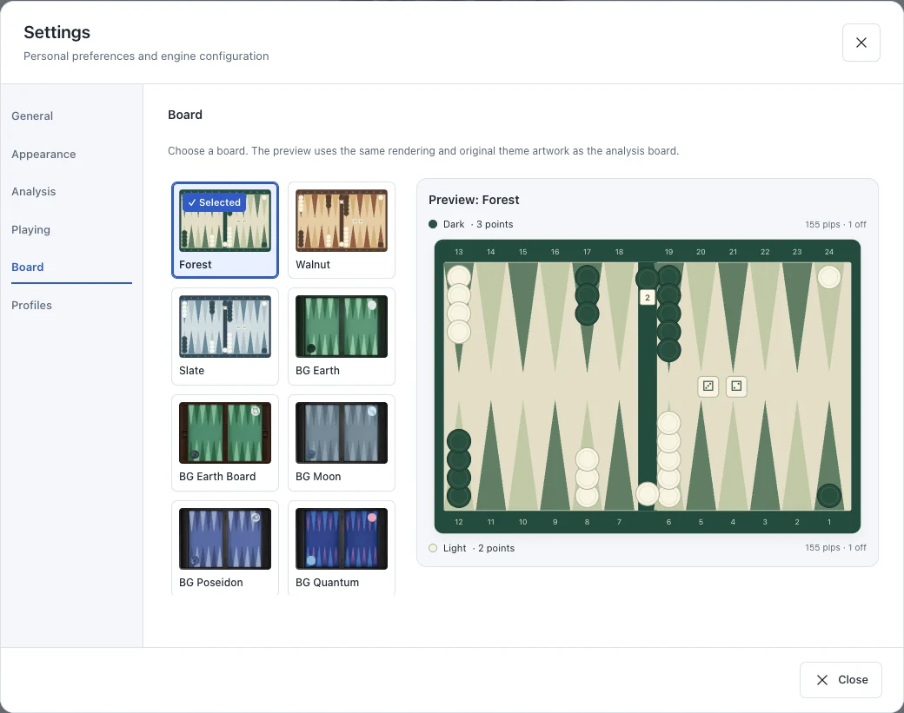 <b>Board</b>: a gallery of board artwork (Forest, Walnut, Slate and local BGBlitz themes) next to a large preview.</td>
<td>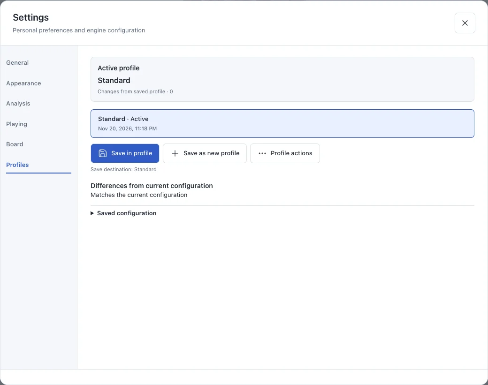 <b>Profiles</b>: the active profile and its changes, <b>Save in profile</b>, <b>Save as new profile</b>, and <b>Profile actions</b> (Rename, Delete).</td>
</tr>
</table>

Details: [Settings and engines](../reference/settings.md#settings-and-engines) · [Themes and language](../reference/settings.md#themes-and-language)

#### Error grades

The error thresholds in **Settings → Analysis** decide how a move is graded in the move history, the statistics, the Cube review and the feedback during play. They are measured in **normalized equity loss**. The defaults are:

| Grade | Default lower bound |
| --- | ---: |
| Questionable | 0.005 |
| Error | 0.020 |
| Blunder | 0.080 |
| Large Blunder | 0.120 |

Each value is the lower bound of its grade, and the four values must increase. When you change them, existing analyses are graded again from their stored losses. *Inaccuracies* in Statistics counts all four grades together. The **Error** threshold also decides when Coach and Tutor intervene in new matches. The settings screenshot above shows a customized *Blunder* value of 0.050.

#### Engines on this computer

Expand **Engines on this computer** to set the GNUbg executable and the Open Sage Python environment, and the maximum number of threads per engine, separately for analysis (including engine duels) and for playing. **Simultaneous analysis jobs** lets several analyses run at the same time; Open Sage still runs one analysis at a time. **Check installation** and **Verify and save** run a real position evaluation before a setting is accepted. BG Tutor never falls back to another engine on its own. A missing engine is reported as unavailable. See also [Local Open Sage setup](../open-sage-local.md).

---

## 10. Learning paths by level

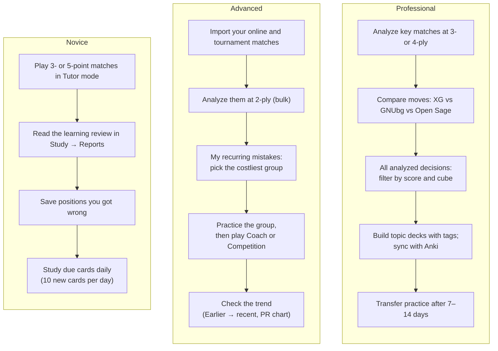

**Novice: learn by playing**

1. Play short matches in **Tutor** mode. When a warning appears, choose **Try again** before you look at **Show solution**.
2. After each match, open the report in **Study → Reports** and walk through *Decisions and attempts*.
3. Save positions you want to remember, and add them to a deck from **Positions** or **Analysis → Study cards**.
4. Spend five minutes a day in **Study → Overview → Study due cards**.
5. Look up unfamiliar terms in the [glossary](#13-glossary).

**Advanced: find and fix your leaks**

1. Import your matches into a database of their own, for example *My Online Games*.
2. In **Player database**, merge your aliases, then choose **Analyze unrated matches …**.
3. In **Study → My recurring mistakes**, sort by equity loss per 100 decisions and practice the top group.
4. Watch your PR chart in the Player database and the *Earlier → recent* trend.
5. Use **Cube** with **Inaccuracies only** to go through every cube error in a match. Compare the take point with the winning chances.

**Professional: precise preparation**

1. Choose the **Displayed analysis** deliberately. Use **Compare saved analyses** to see how much a deeper analysis changes the PR and the error counts.
2. Use **Compare moves** and its **|Δ|** sorting to find positions where the engines disagree. These positions usually deserve a rollout in XG.
3. Use **All analyzed decisions** with score and cube filters to build drill sets for specific match situations.
4. Organize flashcards with hierarchical **topic tags**, sync them with Anki, and measure progress with **Transfer practice**.
5. Use **Benchmark** and **Engine duels** to choose the depth that fits your hardware and time budget.

---

## 11. Keyboard reference

| Where | Key | Action |
| --- | --- | --- |
| Header and tab rows | **Left** / **Right**, **Home** / **End** | Previous or next tab, first or last tab |
| Analysis | **E** / **Shift+E** | Next or previous error in the active review |
| Candidate table and board preview | **Up** / **Down** | Previous or next candidate |
| | **Left** / **Right** | Show *Initial* or *Final* |
| | **Enter** / **Space** | Preview the selected move |
| Board divider | **Left** / **Right** (with **Shift**), **Home** / **End**, **Enter** | Resize the board, jump to the limits, restore the default |
| Playing | **Enter** | Roll, confirm the turn, or pass |
| | **D** | Double |
| | **H** | Hint |
| | **Z** | Undo one checker step |
| | **Escape** | Return from a reviewed move to the game |
| Practice and flashcards | **N** / **D** / **T** / **P** | No double, Double, Take, Pass |
| | **Enter** | Check the answer, then continue |
| | **A** | Show the answer |
| | **1** – **4** | Rate: Again, Hard, Good, Easy |
| Settings | **Up** / **Down**, **Home** / **End** | Switch categories |
| Dialogs and menus | **Escape** | Close and return focus to the button that opened them |

Shortcuts are ignored while you type in a text field. When a dialog is open, only its own buttons react to shortcuts.

---

## 12. Troubleshooting

| Symptom | What to check |
| --- | --- |
| The footer shows that GNUbg is not connected, or analyses fail | **Settings → Analysis → Engines on this computer → Check installation**. GNUbg needs its neural-network weights. Playing also needs GNUbg's embedded Python. |
| Open Sage is unavailable | Enter the Python path of its environment and choose **Verify and save**. See [Open Sage setup](../open-sage-local.md). |
| A move shows a dash instead of a loss | The displayed analysis does not cover this position. Run **Analyze game**, or choose another **Displayed analysis**. |
| No PR is shown | PR needs a **complete** native GNUbg analysis of the match. Imported analyses and partial analyses don't supply PR. |
| *My recurring mistakes* shows nothing | Choose a player, and check the database and minimum-loss filters. The player's matches need an analysis. Use **Analyze in Player database**. |
| An import is rejected | Check the format and its limitations in [Importing](#importing). The error message names the file and the reason. |
| *Apply* reports a conflict | Another browser window saved newer settings. **Apply** retries your changed settings against the newer version. If a profile conflict remains, load the server version or save your changes as a new profile in **Settings → Profiles**. |
| A benchmark is running and other work waits | This is intended. Engine work resumes when the benchmark finishes or is cancelled. |

For installation and server details, see the [project README](../../README.md). Detailed behavior is described in the [reference](../reference/).

---

## 13. Glossary

| Term | Meaning |
| --- | --- |
| **Equity** | The expected result of a position for the player on roll, in points per game. +1.0 means a certain single win. |
| **Equity loss / normalized equity loss** | How much worse a decision is than the best one. *Normalized* makes match-play values comparable with money play. |
| **Error grades** | *Questionable*, *Error*, *Blunder* and *Large Blunder*, defined by the [thresholds](#error-grades). |
| **PR (performance rating)** | 500 × normalized equity loss per decision. Lower is better. Strong experts average in the low single digits. GNUbg and XG count decisions differently, so compare PR values from the same source. |
| **Ply** | Search depth. 0-ply evaluates each resulting position directly, and each additional ply looks ahead one more roll. |
| **Cubeful / cubeless** | Whether the evaluation takes the doubling cube into account. |
| **MWC** | Match winning chances, the probability of winning the match. Used instead of equity in some analyses. |
| **Take point** | The winning chance at which taking a double breaks even. It is 25 % in money play without gammons, and depends on the score in match play. |
| **Crawford game** | The first game after a player reaches match point minus one. No doubling is allowed in that game. |
| **Jacoby rule** | In money play, gammons and backgammons count only if the cube has been turned. |
| **Position ID** | GNUbg's 14-character code for the checker arrangement. It describes the board only. |
| **Match ID** | GNUbg's code for the match context: length, score, cube, dice and turn. |
| **Displayed analysis** | The saved analysis that BG Tutor shows for a match. See [Displayed analysis](#displayed-analysis-and-new-calculations). |
| **Game plan** | BG Tutor's classification of each side's structure: Opening, Pure race, Racing (contact), Attacking / blitz, Priming or Anchoring. |
| **FSRS** | The scheduling algorithm that decides when a flashcard is due again. |
| **Pip count** | The total number of points a player's checkers must travel to bear off. Checkers on the bar count fully. |
